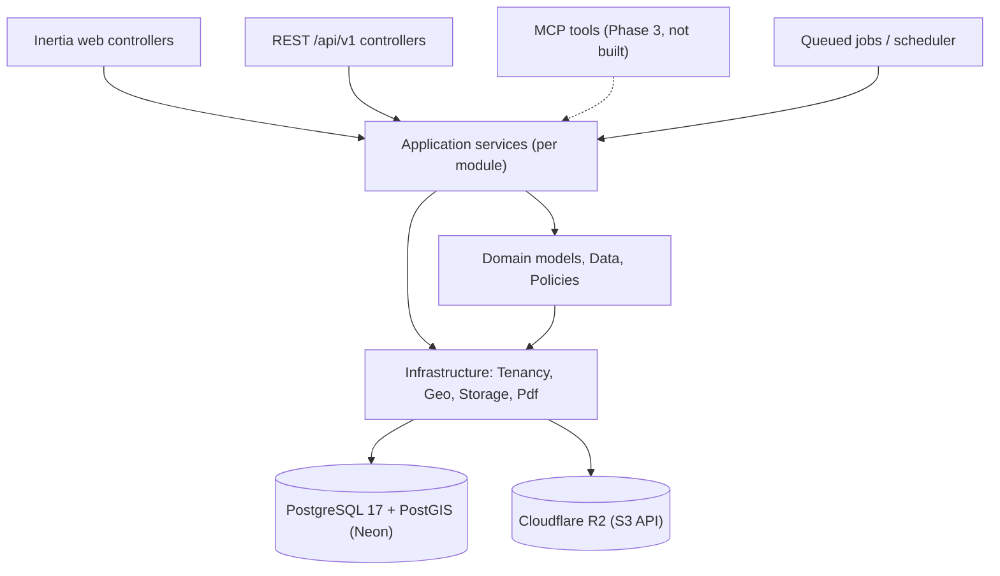
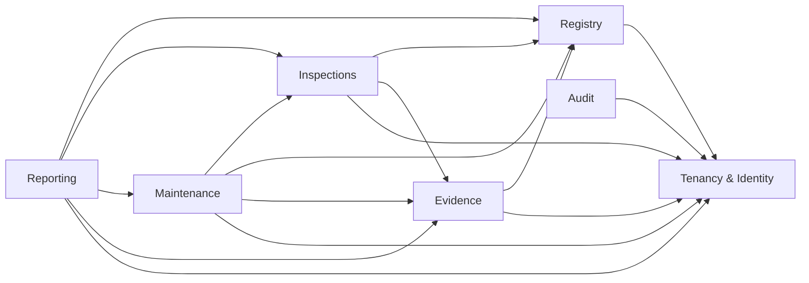
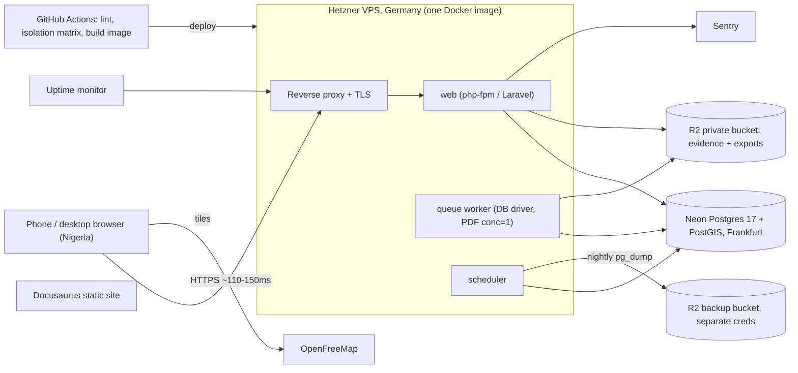
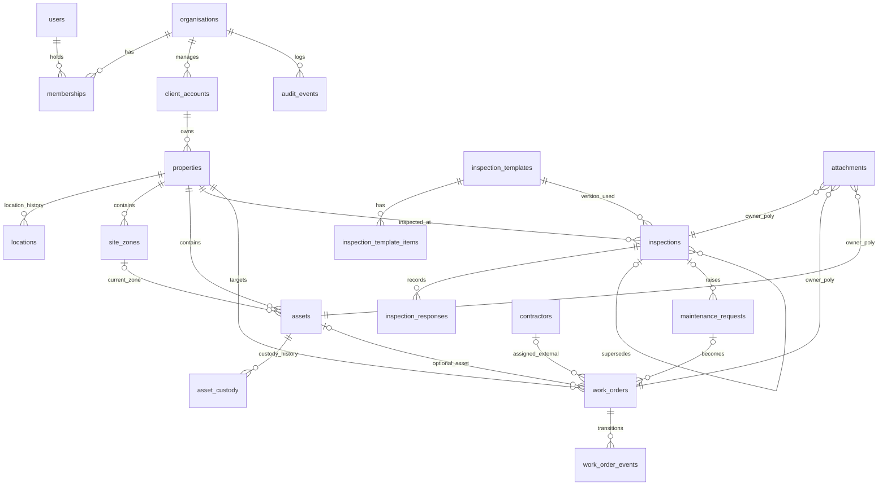

# Architecture Spine: Property & Asset Intelligence (Phase 1)

## Design Paradigm

The system is a **modular monolith, layered with ports**. It is one Laravel app, split into clear domain modules. Every external interface (Inertia controllers, REST API endpoints, scheduled tasks, and future MCP tools) is a thin adapter over the same application services. Dependencies point inward only.

| Layer | Lives in | Holds |
| --- | --- | --- |
| Adapters | `app/Http/Controllers/Web/<Module>`, `app/Http/Controllers/Api/V1/<Module>`, (later) `app/Mcp` | Request validation, invokes one service method, returns Inertia page props or JSON API envelope. Zero business logic. |
| Application services | `app/Domain/<Module>/Services` | All business rules, transactions, role authorisation checks, tenant context verification, and audit event dispatching. |
| Domain | `app/Domain/<Module>/{Models,Data,Policies,Enums,Exceptions}` | Eloquent models, Spatie Data objects, state machine enums, and domain exceptions. |
| Infrastructure | `app/Infrastructure/{Tenancy,Geo,Storage,Pdf}` | Postgres/PostGIS session bindings, `Geo` distance calculations, R2 signed URLs, and PDF generation. |



## Invariants & Rules

### AD-1: Unified service layer; adapters are thin `[ADOPTED]`

- **Binds:** all FRs; every Inertia controller, REST controller, background job, and future MCP tool
- **Prevents:** business rules implemented inside UI controllers or React components, leading to silent divergence across web and API
- **Rule:** Adapters perform exactly three actions: (1) validate request input shape, (2) invoke a single application service method, and (3) format the output into an Inertia response or `{ data, meta }` JSON envelope. Authorisation, state transitions, tenant stamping, and audit logging happen strictly inside the application service. A feature is incomplete without a direct service-layer test.

### AD-2: Strict module ownership of tables and read-only cross-module relations

- **Binds:** all modules
- **Prevents:** multiple modules mutating the same entity under conflicting validation rules; Eloquent relationship write-bypasses
- **Rule:** Each table has exactly one owning module. Only that module's services may write to its tables. Cross-module writes must call the owner's application service (e.g. `Inspections` calls `MaintenanceService::createRequestFromInspection()`, never writing to `maintenance_requests` directly). Eloquent relationships traversing domain boundaries (such as `$workOrder->attachments()`) are strictly **read-only** query scopes; writes to attachments must invoke `EvidenceService`. A separate `approvals` table is strictly prohibited — supervisor sign-off is a timestamp/user field on `inspections` and `work_orders`.

| Module | Owns (writes) |
| --- | --- |
| Tenancy & Identity | `organisations`, `users`, `memberships`, `personal_access_tokens` |
| Registry | `client_accounts`, `properties`, `locations`, `site_zones`, `assets`, `asset_custody` |
| Inspections | `inspection_templates`, `inspection_template_items`, `inspections`, `inspection_responses` |
| Maintenance | `maintenance_requests`, `work_orders`, `work_order_events`, `contractors` |
| Evidence | `attachments` |
| Reporting | *none* (read-only query service aggregating all modules) |
| Audit | `audit_events` |



### AD-3: Tenant resolved exclusively from authenticated session `[ADOPTED]`

- **Binds:** FR-19, FR-1, all tenant tables, all adapters
- **Prevents:** tenant spoofing via forged `organisation_id` in request payloads; divergent tenant resolution logic across routes
- **Rule:** The active tenant is resolved strictly by middleware from the authenticated user's `memberships` row, initializing a `TenantContext` singleton (`organisation_id`, `user_id`, `role`, `client_scope`). `organisation_id` is barred from all Data transfer objects, `$fillable` arrays, FormRequests, and query parameters. A model `creating` hook stamps `organisation_id` from `TenantContext` and aborts if any conflicting value is present.

### AD-4: PostgreSQL RLS backstop with transaction-scoped tenant binding `[ADOPTED]`

- **Binds:** FR-19, NFR-5.1, every tenant table, DB roles, request and job lifecycles
- **Prevents:** application query bugs leaking cross-tenant records; connection-pool leakage in Neon transaction pooling; RLS bypass by privileged database roles
- **Rule:** Tables are strictly classified:
  1. *System Identity Tables (No RLS):* `users`, `organisations`. Queried solely during authentication and initial tenant resolution.
  2. *Tenant Tables (RLS Mandatory):* `memberships`, `client_accounts`, `properties`, `locations`, `site_zones`, `assets`, `asset_custody`, `inspection_templates`, `inspection_template_items`, `inspections`, `inspection_responses`, `maintenance_requests`, `work_orders`, `work_order_events`, `contractors`, `attachments`, `audit_events`.
  Every tenant table enforces: `ENABLE ROW LEVEL SECURITY; FORCE ROW LEVEL SECURITY;` with policy `organisation_id = current_setting('app.org_id', true)::uuid`. The application runtime connects as a **non-owner role without `BYPASSRLS`**; migrations run as an administrative owner role. Tenancy middleware wraps request execution in a database transaction whose first statement is `SET LOCAL app.org_id = ?`, guaranteeing compatibility with Neon's transaction-mode PgBouncer pooler. `[ASSUMPTION: Platform admin support actions occur via an audited membership in the target organization, never via runtime RLS bypass.]`

### AD-5: Client scoping via denormalized `client_account_id` and global scope

- **Binds:** FR-8, FR-15, FR-17, FR-20, FR-21
- **Prevents:** ad-hoc per-module join chains to resolve client accounts; data leaks when technicians access nested endpoints
- **Rule:** `memberships.client_scope` is either `null` (unrestricted organisation-wide access) or an array of permitted `client_account_id`s. Every client-owned entity (`properties`, `site_zones`, `assets`, `inspections`, `maintenance_requests`, `work_orders`, `attachments`) carries a denormalized `client_account_id` stamped immutably at creation from its parent. In addition to the tenant global scope, all client-owned models apply a global `ClientScope` that automatically appends `whereIn('client_account_id', $scope)` when `TenantContext::clientScope()` is non-null. `[ASSUMPTION]`

### AD-6: Universal UUID primary and foreign keys

- **Binds:** all tables, REST API, storage keys
- **Prevents:** integer/UUID type mismatch breaking the `::uuid` RLS cast; ID enumeration vulnerabilities in URLs
- **Rule:** All database tables use ordered UUID primary keys (`Laravel\Database\Eloquent\Concerns\HasUuids`). No autoincrement integer IDs are exposed in routes, API serializers, or database foreign keys.

### AD-7: Canonical Point geometry storage and single geographic mutator `[ADOPTED]`

- **Binds:** FR-3, FR-7, NFR-5.1
- **Prevents:** coordinate drift between duplicate lat/lng and geometry columns; degree-versus-metre calculation errors; coordinate-inversion bugs
- **Rule:** `properties.geom geometry(Point, 4326)` with a GiST index is the single source of truth. `properties.geom` is guarded from direct mass-assignment. Initial property creation and updates must invoke `LocationService::setLocation($property, $lat, $lng, $accuracy_m, $source)`, which executes `geom = ST_SetSRID(ST_MakePoint(lng, lat), 4326)` and appends a `locations` row within the same transaction. Latitude and longitude are derived exclusively in serializers via `ST_Y(geom)` and `ST_X(geom)`. All distance calculations must call `Geo::distanceMetres()` / `Geo::withinMetres()` using the `::geography` cast.

### AD-8: Append-only history tables; latest row defines current state

- **Binds:** FR-3, FR-6, FR-13–FR-16, FR-22
- **Prevents:** historical audit trail destruction; conflicting definitions of "current" state
- **Rule:** `locations`, `asset_custody`, `work_order_events`, and `audit_events` are strictly append-only. The application runtime database role has no `UPDATE` or `DELETE` grants on these tables. The current state is resolved by ordering by `captured_at` or `created_at` descending. Deletions for NDPA compliance run exclusively through dedicated administrative maintenance scripts (see Deferred).

### AD-9: Asset timeline assembled dynamically as a read model

- **Binds:** FR-16, FR-17
- **Prevents:** a redundant, de-synchronized timeline table falling out of step with actual domain events
- **Rule:** The asset timeline is a computed read-model query compiled by `Registry` querying `inspections`, `work_order_events`, `asset_custody`, and `attachments`. No separate `timeline_events` table exists.

### AD-10: Inspection templates versioned by row; inspections immutable upon approval

- **Binds:** FR-10, FR-11
- **Prevents:** in-flight or historical inspections changing when a template is updated; post-approval tampering
- **Rule:** Template rows carry `template_family_id` and `version`. Editing a template version that is referenced by any existing inspection creates a new row with incremented version. When an inspection is scheduled/created, it permanently binds to that exact `inspection_template_id`. Once `approved_at` is populated, the inspection rejects all updates. Corrections must be created as a new inspection linking to the original via `supersedes_id`.

### AD-11: Encapsulated work order state machine and evidence immutability

- **Binds:** FR-13, FR-14, FR-15
- **Prevents:** invalid status jumping directly from controllers; completing work orders without verified evidence; deleting evidence after completion
- **Rule:** Work order status changes execute exclusively through `WorkOrderService::transition($workOrder, $newStatus, $actor, $note)`. Allowed transitions: `open → assigned → in_progress → completed`, with `on_hold` and `cancelled` permitted from non-terminal states, and `on_hold → in_progress` permitted. Every transition appends a `work_order_events` entry. Transition to `completed` strictly requires at least one photo attachment with a valid `captured_at` timestamp. Lack of GPS coordinates never blocks completion. Once a work order is `completed` (or an inspection approved), associated attachments are immutable and cannot be deleted via standard user actions.

### AD-12: Service-layer authorization via unified role policy

- **Binds:** FR-20, FR-15, FR-21
- **Prevents:** authorization logic implemented in controllers being bypassed by API or queued job entry points
- **Rule:** The role-ability matrix for the six Phase 1 roles (Platform admin, Organisation owner, Operations manager, Site supervisor, Technician, Contractor) is codified in central policies. Every application service method verifies the actor's abilities against the targeted resource and client scope prior to executing business logic. Multi-role memberships inherit the union of their role permissions.

### AD-13: Private evidence storage with provenance and signed URL gateway

- **Binds:** FR-21, FR-15, FR-11, FR-18
- **Prevents:** unauthenticated file downloads, path traversal, or unlinked orphan attachments in storage
- **Rule:** File uploads are processed through `EvidenceService`, validating MIME type and size, writing to Cloudflare R2 via Laravel's `s3` disk at `organisations/{org}/clients/{client}/{owner_type}/{owner_id}/{uuid}.{ext}`. Provenance fields (`uploaded_by`, `uploaded_at`, `client_account_id`, polymorphic parent, optional coordinates) are persisted. Read access is granted exclusively through short-lived signed URLs (10-minute TTL) generated only after verifying the user's tenant and client scope.

### AD-14: Explicit tenant context propagation for background jobs

- **Binds:** FR-18, FR-23, NFR-5.1
- **Prevents:** background workers executing without tenant isolation or leaking context between queue executions
- **Rule:** All queued jobs implement the `TenantAware` interface, serializing `organisation_id` and `user_id`. A dedicated job middleware reconstructs `TenantContext` and executes `SET LOCAL app.org_id = ?` within a transaction before `handle()` runs. Scheduled tasks iterate organizations explicitly and establish scoped tenant contexts sequentially. Unscoped job execution is fatal.

### AD-15: Unified report read model with dual renderers and constrained concurrency

- **Binds:** FR-17, FR-18
- **Prevents:** data discrepancies between PDF and CSV exports; VPS out-of-memory crashes from headless browser processes
- **Rule:** `ReportService::compile($clientAccount, $period)` returns a canonical `ReportData` object. Both the PDF view (rendered via `spatie/laravel-pdf` and headless Chromium) and the CSV export are generated directly from this single data structure. Report generation runs asynchronously via queued `TenantAware` jobs writing to R2 and notifying the user. PDF export queue workers are constrained to concurrency = 1 on the 4GB VPS to guard against Chromium memory spikes.

### AD-16: Strongly-typed Data objects as the full-stack contract

- **Binds:** all adapters, Inertia frontend props, OpenAPI generation
- **Prevents:** frontend/backend shape drift; discrepancies between Inertia and REST serializers
- **Rule:** Application service inputs and outputs are defined as Spatie `Data` objects. These DTOs back both REST API resources and Inertia page props. TypeScript interfaces in `resources/js/types/generated` are automatically generated from PHP Data classes via `spatie/typescript-transformer`. Hand-crafted duplicate TypeScript interface definitions are forbidden.

### AD-17: Standardized error envelope and domain exception mapping

- **Binds:** all adapters, NFR-5.3
- **Prevents:** leaking raw database syntax errors to clients; inconsistent API error formatting
- **Rule:** Application services throw domain-specific exceptions extending `DomainException`, carrying a permanent machine-readable error code (e.g. `work_order_invalid_transition`). A centralized exception handler translates these into `{ "error": { "code", "message" } }` for REST endpoints and mapped validation/flash errors for Inertia requests. Uncaught database exceptions are sanitized and reported to Sentry.

### AD-18: Atomic audit logging within the originating transaction

- **Binds:** FR-22, FR-23
- **Prevents:** unrecorded administrative actions, or audit trails logging actions that rolled back
- **Rule:** `AuditService::record($action, $target, $metadata)` is invoked within the active database transaction for all sensitive operations: authentication events, data exports, role/scope adjustments, record deletions, and NDPA data subject requests.

### AD-19: Real PostgreSQL/PostGIS test execution with non-owner RLS enforcement

- **Binds:** NFR-5.1, AGENTS.md §6
- **Prevents:** false-positive isolation passes caused by SQLite or running tests as a database superuser
- **Rule:** Test suites run against a real PostgreSQL 17 + PostGIS instance. The test runner connects using the same non-owner application role as production. A shared tenant-isolation matrix tests each core entity across five vectors: **HTTP requests, direct service calls, raw SQL queries, queued jobs, and signed URL generation**, verifying that cross-tenant access is rejected and forged `organisation_id` headers or payloads are ignored.

### AD-20: Cloud- and AI-agnostic infrastructure abstractions `[ADOPTED]`

- **Binds:** all infrastructure, AGENTS.md rules 3–4
- **Prevents:** vendor lock-in to proprietary cloud APIs or single AI/map providers
- **Rule:** The codebase interacts with external services exclusively through portable abstractions: standard Postgres/PostGIS SQL, S3-compatible file storage via Laravel's filesystem abstraction, and environment-configured map tile endpoints. Domain code must never import proprietary cloud SDKs. Nightly database backups perform portable `pg_dump` exports to an isolated secondary R2 bucket.

### AD-21: Concurrency locks, unique constraints, and idempotent queue consumers

- **Binds:** FR-5, FR-10, FR-13–FR-15, FR-18, NFR-5.3
- **Prevents:** race conditions causing duplicate work order transitions, colliding template version numbers, duplicate asset tags, or duplicate PDF report jobs exhausting worker memory
- **Rule:** State-mutating operations subject to concurrent writes must enforce database-level locking and uniqueness:
  1. `WorkOrderService::transition()` and `InspectionService::approve()` acquire a pessimistic row lock (`SELECT ... FOR UPDATE` via `lockForUpdate()`) inside the active transaction before verifying current status and appending history events.
  2. Database migrations enforce composite unique indexes on `(organisation_id, property_id, tag)` for `assets` and `(organisation_id, template_family_id, version)` for `inspection_templates`.
  3. Queued jobs implement `ShouldBeUnique` (keyed by `organisation_id` + target entity/period) with explicit `$tries`, `$backoff`, and `$timeout` limits, routing terminal failures to `failed_jobs` and alerting Sentry.

### AD-22: Tiered rate limiting, magic-byte upload verification, and HTTP security headers

- **Binds:** FR-18, FR-21, NFR-5.1, NFR-5.3
- **Prevents:** credential stuffing on auth routes, Chromium worker exhaustion from repeated report exports, malicious file uploads via spoofed extensions, and XSS/clickjacking vectors
- **Rule:**
  1. **Rate Limiting:** Named `RateLimiter` policies enforce strict per-IP and per-user/org thresholds across four route tiers: authentication (`5/min` per IP+email), evidence uploads (`30/min` per user), async report exports (`5/min` per organisation), and general `/api/v1` endpoints (`120/min` per user), returning HTTP `429 Too Many Requests` with a `Retry-After` header.
  2. **Upload Hardening:** `EvidenceService` verifies uploaded files using server-side magic-byte MIME detection (`finfo`), strips executable/HTML payloads, enforces a strict allowlist (`image/jpeg`, `image/png`, `image/webp`, `application/pdf`) and max size (`10 MB`), and sets `Content-Disposition: attachment` on non-image signed URLs.
  3. **Security Headers:** Middleware enforces HSTS (`Strict-Transport-Security`), `X-Content-Type-Options: nosniff`, `X-Frame-Options: DENY`, `Referrer-Policy: strict-origin-when-cross-origin`, and a Content Security Policy (CSP) scoped to self, R2 signed URLs, and OpenFreeMap tile origins.

## Consistency Conventions

| Concern | Convention |
| --- | --- |
| **Naming** | Database tables use plural snake_case (glossary **Zone** maps to `site_zones`). Modules use PascalCase under `app/Domain`. Services are named `<Entity>Service`. Data objects are `<Entity>Data` / `Create<Entity>Data`. State enums are `<Entity>Status`. Inertia pages reside in `resources/js/pages/<module>/<Page>.tsx`. |
| **Identifiers & Time** | UUID strings exclusively; timestamps stored as `timestamptz` in UTC, transmitted in ISO-8601, and rendered in client UI localized to `Africa/Lagos`. |
| **Units & Coordinates** | Distances always calculated in metres. Coordinates stored as WGS 84 (`4326`), with latitude/longitude exposed only as derived fields. |
| **External & Postcodes** | Postcode validation (NIPOST) is server-side, feature-flagged, and strictly non-blocking. Only verification outcome is recorded; third-party datasets are never stored locally. |
| **Mobile & Network** | Frontend client-side image downscaling (max 1920px, WebP/JPEG) prior to upload to optimize for Nigerian mobile data connections and reduce transfer failures. |
| **REST API** | Scoped under `/api/v1`, plural nouns, nested sub-resources, `{ data, meta }` response envelope, cursor pagination in `meta`, and automated OpenAPI generation. |
| **Errors** | `{ error: { code, message } }` with permanent snake_case codes. |
| **Transactions** | One transaction per service command, initiated by the tenancy middleware or job runner. Services do not invoke nested transactions. |
| **Logging** | Structured JSON containing `org_id`, `user_id`, and `request_id`. Personal data and credentials must never appear in log payloads. |
| **Frontend UI** | Tokens from `docs/cloud_crafters_design_system/` mapped into Tailwind 4 `@theme`. Re-skinned shadcn/ui components. Unified `<PropertyMap>` component wrapping MapLibre GL JS. Compliance with WCAG 2.1 AA. |
| **Documentation** | Monorepo Docusaurus site in `docs-site/`. Documentation describes only verified, tested code. Knowledge base files updated in the same changeset as functional changes. |

## Stack

| Name | Version |
| --- | --- |
| PHP | 8.4 (supported range 8.3–8.5) |
| Laravel (Official React Starter Kit) | 13.x |
| Inertia.js (`@inertiajs/react`, `inertia-laravel`, `@inertiajs/vite`) | 3.x |
| React + TypeScript | 19.x + 5.x |
| Tailwind CSS + shadcn/ui | 4.x + current CLI (`@tailwindcss/vite`) |
| Laravel Sanctum | 4.x |
| Pest PHP | 3.x / 4.x |
| PostgreSQL + PostGIS (Neon EU Central) | 17 + 3.5.7 |
| MapLibre GL JS + OpenFreeMap | 5.x (stable) |
| spatie/laravel-pdf (Browsershot + Chromium) | 1.x |
| spatie/laravel-data + typescript-transformer | 4.x + 2.x |
| Docusaurus | 3.x |
| Runtime & Container | Docker on Hetzner VPS (Germany) |

## Structural Seed

### Deployment & environments



| Env | App | DB | Storage |
| --- | --- | --- | --- |
| local | `docker compose` (same app Dockerfile) | `postgis/postgis:17` container | S3-compatible container (RustFS, pinned by digest) |
| staging | same Docker image, staging VPS | Neon branch (free tier) | R2 staging bucket |
| production | Hetzner VPS | Neon paid tier (PITR) | R2 prod bucket + isolated backup bucket |

Local object storage is any maintained S3-compatible service; the application reaches it only through Laravel's `s3` disk and `AWS_*` environment variables, so local and production differ by configuration alone. MinIO's public images were withdrawn, and LocalStack was rejected: its current image requires a paid auth token and its last free tag ignores bucket policies (private objects were retrievable anonymously in verification).

### Core entities



### Source tree

```text
project/
  app/
    Domain/
      Tenancy/  Registry/  Inspections/  Maintenance/  Evidence/  Reporting/  Audit/
        # each contains: Services/ Models/ Data/ Policies/ Enums/ Exceptions/
    Infrastructure/
      Tenancy/   # TenantContext, TenantScope, ClientScope, SET LOCAL middleware, TenantAware job middleware
      Geo/       # Geo::distanceMetres / withinMetres
      Storage/   # R2 evidence disk and signed URL generator
      Pdf/       # Spatie Laravel PDF renderer wrapper
    Http/Controllers/
      Web/<Module>/      # Inertia adapters
      Api/V1/<Module>/   # REST API adapters
  database/migrations/   # schema migrations, RLS policies, DB role grants
  resources/js/
    pages/<module>/      # Inertia page views
    components/          # re-skinned shadcn components, PropertyMap
    types/generated/     # spatie/typescript-transformer output
  tests/
    Feature/<Module>/    # functional domain tests
    Isolation/           # 5-layer tenant isolation matrix
  docs-site/             # Docusaurus documentation site
  docs/knowledge-base/   # single source of truth architectural docs
```

## Capability → Architecture Map

| Capability / Area | Lives in | Governed by |
| --- | --- | --- |
| FR-1 client accounts | Registry | AD-2, AD-3, AD-5 |
| FR-2 property, postcode | Registry | AD-2, AD-3; non-blocking postcode convention |
| FR-3 location + history | Registry (`LocationService`), Infrastructure/Geo | AD-7, AD-8 |
| FR-4 zones, FR-5 assets | Registry | AD-2, AD-5, AD-21 |
| FR-6 custody | Registry | AD-8 |
| FR-7 map display | `resources/js` `<PropertyMap>` | AD-7, Frontend convention |
| FR-8 client asset list | Registry | AD-5, AD-12 |
| FR-9–FR-11 inspections and templates | Inspections | AD-10, AD-13, AD-21 |
| FR-12 maintenance request | Maintenance | AD-2 |
| FR-13–FR-15 work orders | Maintenance | AD-11, AD-12, AD-13, AD-21 |
| FR-16 asset history | Registry read model | AD-9 |
| FR-17–FR-18 reports | Reporting, Infrastructure/Pdf | AD-14, AD-15, AD-18, AD-21, AD-22 |
| FR-19 tenant resolution | Infrastructure/Tenancy | AD-3, AD-4 |
| FR-20 roles | Tenancy + per-module Policies | AD-12 |
| FR-21 evidence | Evidence, Infrastructure/Storage | AD-13, AD-22 |
| FR-22 audit | Audit | AD-18 |
| FR-23 NDPA ops | Audit + Tenancy (retention job) | AD-8, AD-14, Deferred |
| NFR-5.1 isolation | cross-cutting | AD-3, AD-4, AD-19, AD-22 |
| NFR-5.2 mobile network performance | Frontend + Evidence | Frontend image downscaling convention |
| NFR-5.3 backups, errors | Ops, all adapters | AD-17, AD-20, AD-21, AD-22 |
| NFR-5.4 accessibility | `resources/js` | Frontend convention (WCAG 2.1 AA) |
| NFR-5.5 observability | Ops | Logging convention, Deployment topology |

## Deferred

- **PostGIS installation schema on Neon.** Awaits the week-1 technical spike (PRD Open Question #1 / D1) before locking the database schema. AD-7 remains resilient regardless of schema placement.
- **Specific NDPA retention durations and pruning schedule.** The retention threshold values are PRD Open Question #7. The execution mechanism (an audited, tenant-aware administrative job with elevated delete privileges) is architectural invariant AD-8/AD-14.
- **Tile hosting resilience & fallback.** OpenFreeMap permits commercial use but carries no SLA. If pilot usage experiences degradation, self-hosting vector tiles will be evaluated. Encapsulation inside `<PropertyMap>` guarantees a zero-refactor swap.
- **Redis caching and horizontal scaling.** Deferred until database queues or single-VPS compute thresholds are exceeded (D6).
- **Exhaustive role-ability matrix details.** High-level role definitions are bound in AD-12; fine-grained permissions per endpoint will be finalized in the foundations epic.
- **Phase 3 surfaces.** External OAuth/Passport, public developer portal, MCP tools, webhooks, native mobile/desktop apps, and self-service client portals remain deferred until post-pilot validation.
